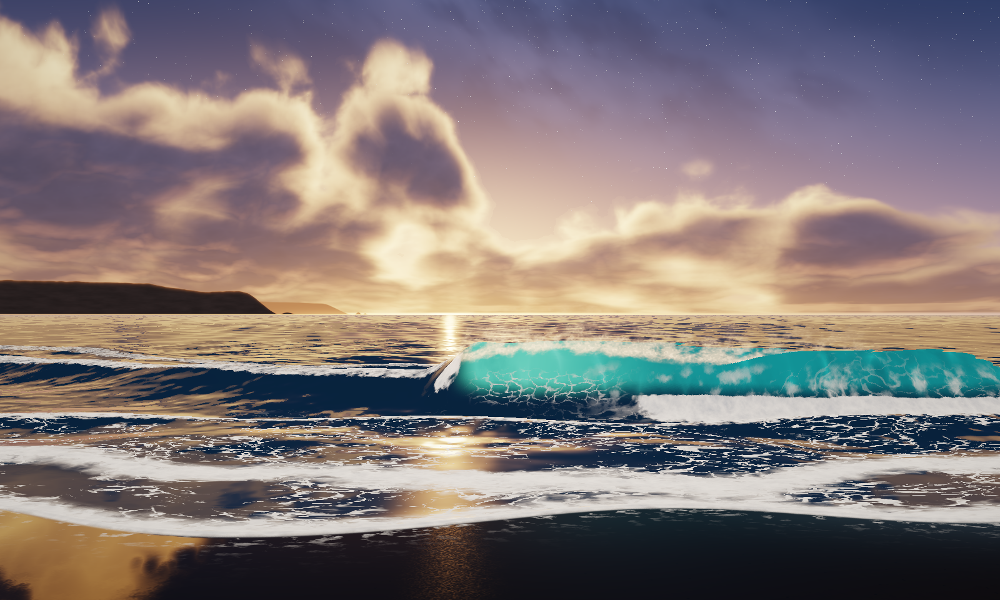
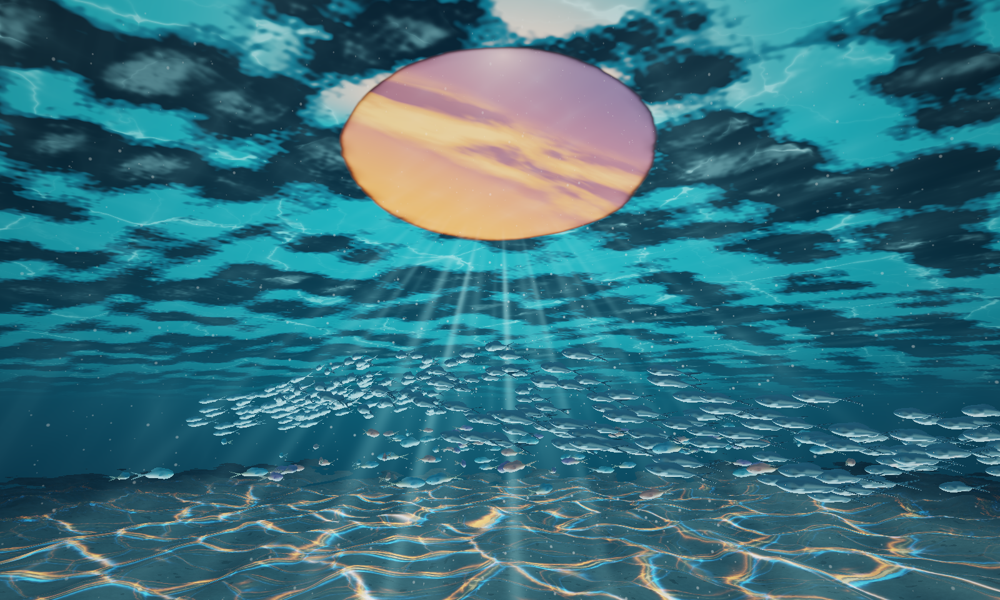

# Three.js Photoreal Ocean, Volumetric Sky & Underwater Snell's Window

A zero-dependency, browser-only real-time **Three.js + WebGL2** photorealistic coastal ocean, volumetric sky, and underwater Snell's Window simulation—featuring multi-scale cellular sea-foam physics, subsurface light transport, chromatic RGB seabed caustics, and **415 GPU-instanced 3D schooling fish**.





---

## ✨ Key Features

### 1. Ocean Surface Hydrodynamics & Shoreline Optics (`modules/ocean_surface_glsl.js`)
- **Asymmetric Plunging Breaker & Cross-Swells**: Right-of-center hollow sea-emerald plunging wave packet combined with left-of-center diagonal swell ridges and an 8-direction JONSWAP/Gerstner capillary wave spectrum.
- **Subsurface Light Transport (SSS)**: Beer-Lambert emerald-aquamarine transmission through the thin pitching wave wall, modulated by internal refracted caustic veins and backlit flying spindrift spray off the crest lip.
- **Multi-Scale Advected Voronoi Cellular Foam**: Dual-octave 2D Voronoi (`F2 - F1` Plateau-border bubble filaments + `F1` micro-bubble clusters) warped by multi-stage FBM curl turbulence inside the hollow barrel pocket and across double parabolic swash lobes.
- **Thin-Film Wet Beach Sand Mirror**: `C¹`-continuous nearshore-to-beach bathymetry with a raised 3D capillary meniscus swash lip, contact shadow, and anisotropic sand-grain sun glitter reflecting the clouds and breaking wave.
- **Distance-Filtered Normal Variance (Toksvig / LEAN)**: Smoothly widens specular roughness with ray distance so the horizon shimmers without sub-pixel aliasing.

### 2. Volumetric Sky, Atmosphere & Starfield (`modules/sky_atmosphere_glsl.js`)
- **Perspective Worley-FBM Cumulus Towers**: True 3D perspective-foreshortened cloud shell combining inverted Worley cellular domes with ridged billows.
- **Radiative Transfer**: 4-step volumetric self-shadowing toward the sun with Beer-Powder multiple scattering and a dual-lobe Henyey-Greenstein phase function (deep charcoal-indigo convective bases vs. molten amber-gold forward-scattered rims).
- **Distant Coastal Headland**: Two-layer atmospheric sea-cliff silhouette on the far-left horizon veiled in golden aerial perspective haze and surf mist.
- **Astronomical Starfield & Milky Way**: Multi-octave pinpoint stars with blackbody stellar color temperatures (`O/B/A/F/G/K/M`) and a tilted galactic dust band that emerges as you scrub from Day to Twilight to Starry Night.

### 3. Underwater Snell's Window, Chromatic Caustics & 415 3D Fish (`modules/underwater_glsl.js`, `modules/fish_school_system.js`)
- **Optical Snell's Window ($\text{IOR } 1.333 \to 1.0$)**: Refracted overhead sunset sky and clouds inside the $48.6^\circ$ critical-angle cone, surrounded by glossy 3D Total Internal Reflection (TIR) wave underside facets.
- **Chromatic RGB Dispersion Caustics**: Dual-scale animated Voronoi cellular cusps + wave interference sampled along wavelength-dispersed refraction offsets (`R`, `G`, `B`) over 3D current-sculpted sinuous sand ripples.
- **Volumetric God-Ray Shafts & Bubble Plume**: 10-step 3D caustic-modulated crepuscular sunbeams and a turbulent rising micro-bubble plume beneath the breaking wave.
- **415 Instanced 3D Vertebrate Fish**:
  - **320 Silver-Blue Pelagic Fusiliers** + **95 Tropical Reef Fish** generated procedurally with sleek fusiform bodies, narrow caudal peduncles, swept dorsal/pectoral fins, and deeply forked lunate caudal tails.
  - GPU vertex-shader spinal swimming undulation, curvature-driven banking roll angles, diamond scale micro-iridescence, countershading, and live RGB caustic projection.

---

## 🚀 Quick Start (Zero Build Step Required)

Clone the repository and serve the root directory with any static HTTP server:

```bash
git clone https://github.com/oh-ashen-one/threejs-photoreal-ocean.git
cd threejs-photoreal-ocean
python3 -m http.server 8900
```

Then open **`http://localhost:8900/`** in your browser.

---

## 🎮 Interactive Controls

| Control | Action |
| :--- | :--- |
| **🤿 Dive Underwater & Look Up** / `Space` | Smoothly submerge beneath the breakers and tilt upward toward Snell's Window and the fish schools |
| **🏖 Beach Shoreline** / **🫧 Underwater** / **🌊 Split Waterline** / **🐠 Deep Fish School** | Instant camera presets |
| **Mouse Drag** | 360° look around (above or below water) |
| **Scroll Wheel** or `W` `A` `S` `D` / `E` `Q` | Move across the shoreline or dive manually across the air-water meniscus |
| **🌅 Twilight Slider** | Scrub smoothly between **Day**, **Golden Twilight**, and **Starry Night** |
| **🌊 Chop Slider** | Adjust ocean wave height and capillary wind chop in real time |
| **`H` Key** | Toggle the HUD off/on for a clean full-screen view |

---

## 📁 Repository Structure

```text
├── index.html                        # Self-contained UI, presets & entry point
├── ocean_app.js                      # Main Three.js WebGL2 pipeline, render targets & camera controller
├── three.module.js                   # Bundled Three.js ES module (zero npm install required)
├── modules/
│   ├── sky_atmosphere_glsl.js        # Volumetric Worley-FBM clouds, atmosphere, starfield & coastal cliffs
│   ├── ocean_surface_glsl.js         # Plunging wave packet, Voronoi cellular foam, swash lobes & wet sand
│   ├── underwater_glsl.js            # Snell's Window, 3D TIR ceiling, 3D sand ripples & RGB caustics
│   └── fish_school_system.js         # Procedural 3D vertebrate fish geometry, shaders & schooling animation
├── references/                       # AI target reference frames used to guide shader engineering
└── screenshots/                      # Captured renders (shoreline, underwater Snell's Window, starry night)
```

---

## 📄 License

Released under the [MIT License](./LICENSE).
